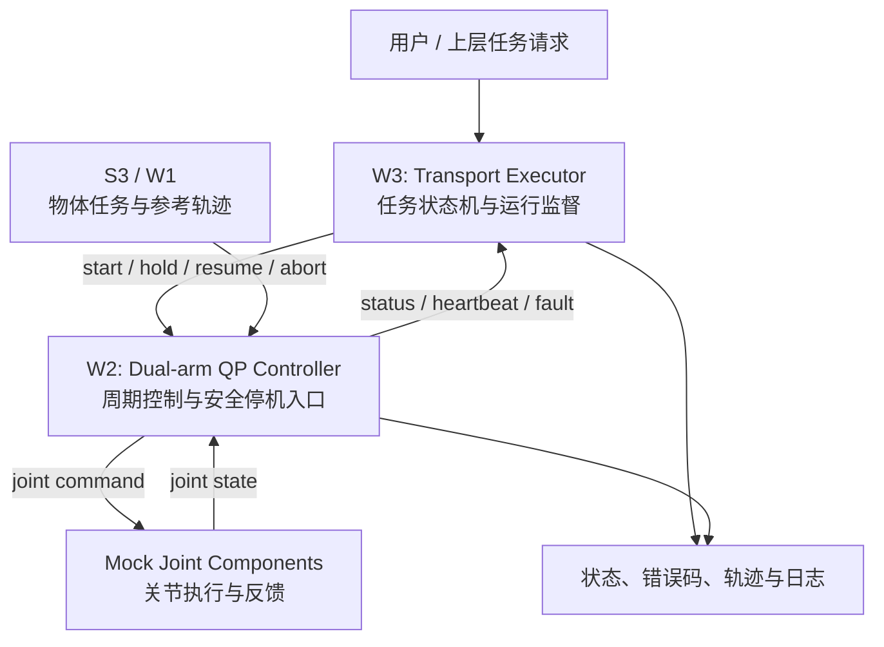
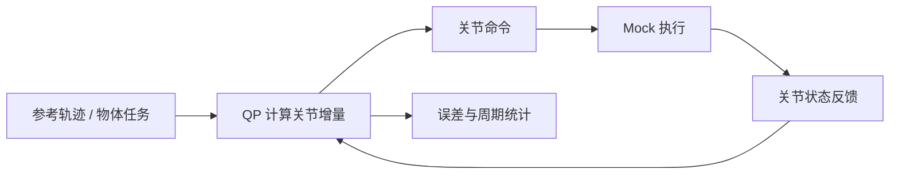
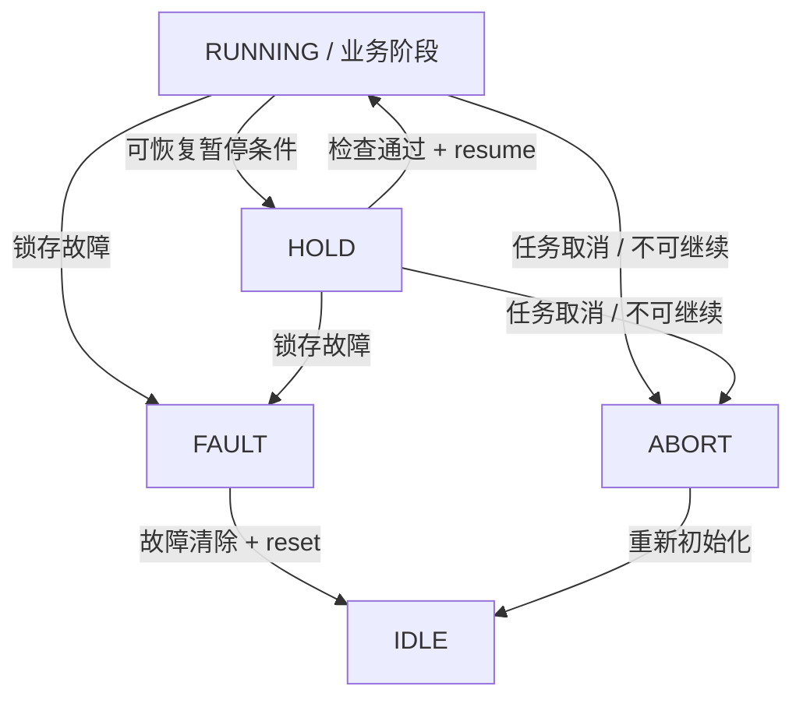

# C4.3 S4 — W2 / W3 任务说明与验收边界

> **文档类型**：阶段任务说明（非验收报告）  
> **所属阶段**：C4.3 / S4.1 — 双臂协同搬运的控制与执行基础  
> **适用范围**：ROS 2、双臂 QP 控制器、mock 台架与上层任务执行器  
> **维护原则**：实际完成状态、数值指标和测试结论，以相应代码提交及验收记录为准。

## 1. 背景与目标

S4 需要把前期得到的双臂协同搬运轨迹，逐步转化为**可执行、可监控、可中止**的机器人任务。

这一过程不能只验证“QP 能求出关节命令”，还必须明确：

- 关节控制器是否在 ROS 2 闭环中持续按预期运行；
- 任务由谁启动、暂停、恢复和终止；
- 当执行器退出、反馈过期或其他异常发生时，系统如何进入安全状态；
- 哪些结论仅适用于 mock 台架，哪些尚需 Gazebo 物理仿真或真机验证。

因此，W2 和 W3 是相邻但不同的两个工作包：

> **W2 验证控制器“能否正确执行”；W3 验证任务“能否被可靠组织，并在异常时受控停止”。**

两者均不等价于完成真实物体的双臂协同搬运。

## 2. W2 与 W3 总览

| 对比项 | W2：控制器台架闭环验证 | W3：上层任务执行器 |
| --- | --- | --- |
| 主要目标 | 验证双臂控制器的数值一致性与闭环行为 | 组织搬运任务生命周期并处理异常 |
| 责任层 | 实时/周期性控制层与测试台架 | 上层任务协调与监督层 |
| 核心关注 | QP 求解、轨迹跟踪、反馈更新、周期统计 | 状态机、心跳监测、超时、HOLD/ABORT/FAULT |
| 主要输入 | 搬运参考轨迹、双臂关节状态、控制参数 | 用户任务请求、控制器状态、错误/超时事件 |
| 主要输出 | 关节控制命令、误差与运行日志 | 任务状态、控制请求、故障原因及任务日志 |
| 主要环境 | ROS 2 + `mock_components` | ROS 2 + mock 台架（优先） |
| 是否包含真实接触/夹持物理 | 否 | 否 |
| 完成后证明的内容 | 软件闭环与异常处置的部分性质 | 任务协调与故障状态迁移的部分性质 |

### 2.1 系统层次

**层次原则**：W3 负责决定任务如何推进，不应接管 QP 的逐周期数值求解；W2 所在的控制层不应依赖 W3“正常退出后再通知停止”才能进入安全状态。

## 3. W2：控制器台架闭环验证

### 3.1 工作目的

W2 的目标，是在没有真实抓取物理的条件下，验证 W1 接入的物体任务、参考轨迹和双臂 QP 控制器，能否在 ROS 2 控制周期内构成可检查的反馈闭环。

典型数据流：

### 3.2 主要工作内容

1. **轨迹数值对拍**：在约定的相同状态、轨迹和参数条件下，对照此前的数学/离线实现，检查控制器输出的关节增量及其误差。
2. **ROS 2 闭环执行**：验证状态读取、QP 求解、命令发送和反馈更新能够形成连续闭环，而非只运行单次求解。
3. **搬运目标跟踪**：记录双臂关节跟踪误差及由模型计算的物体目标位姿误差，并说明误差统计口径。
4. **心跳与 HOLD 行为**：验证上层心跳失效后，控制器能在规定条件下进入 HOLD；暂停期间参考轨迹时间不继续推进。
5. **运行周期与稳定性**：记录控制周期分布、求解耗时、异常周期、持续运行情况，并检查是否存在控制路径动态内存分配风险。
6. **失败可追溯**：保存输入、输出、关键时间戳、求解状态及异常原因，以便复现失败案例。

### 3.3 W2 的交付物

- 可重放的 mock 台架启动/测试入口和配套配置；
- 控制器执行日志、轨迹跟踪结果和逐周期数值对照结果；
- 心跳丢失、暂停/恢复等测试证据；
- 包含**通过项、未通过项、未测试项**的 W2 验收记录。

### 3.4 W2 不证明什么

mock 关节执行**不包含**真实物体质量、夹持力、末端接触、摩擦、滑移、重力扰动和实体碰撞等因素。

因此，W2 通过只意味着特定软件台架上的控制闭环获得验证，**不能据此宣称 Gazebo 物理搬运成功或双臂真机搬运安全**。

## 4. W3：双臂搬运任务执行器

### 4.1 工作目的

W3 规划建设上层 ROS 2 任务执行器 `dual_arm_transport_executor`，统一负责搬运任务的**启动、状态推进、运行监督、超时与故障处理、终止和记录**。

它使用现有轨迹与控制器能力，不在 W3 中重复实现运动学、QP 求解或路径规划。

### 4.2 任务阶段设计

建议采用以下业务阶段作为完整搬运流程的**目标状态模型**：

各阶段的职责：

| 阶段 | 业务含义 | W3 中的合理边界 |
| --- | --- | --- |
| `IDLE` | 待机，等待新任务 | 可实现 |
| `APPROACH` | 接近预定抓取位姿 | 先定义状态与阶段推进规则 |
| `GRASP` | 执行夹取 | 先预留控制接口；真实夹爪和接触验证不属于 W3 完成条件 |
| `LIFT` | 抬升物体 | 先建立状态和调度骨架 |
| `TRANSPORT` | 双臂协同搬运 | 接入已验证控制器及运行监督 |
| `LOWER` | 降低物体 | 先建立状态和调度骨架 |
| `RELEASE` | 释放物体 | 先预留接口；真实 attach/detach 依赖后续阶段 |
| `COMPLETE` | 任务正常结束 | 记录成功及结束原因 |

**注意**：上述完整任务序列是架构目标，不表示 W3 已实现每一步物理操作。W3 阶段应优先完成可在 mock 条件下验证的状态机骨架和监督逻辑。

### 4.3 HOLD / ABORT / FAULT 语义

三个异常状态必须区分，不能用一个“停止”覆盖所有情形。

| 状态 | 语义 | 恢复规则 |
| --- | --- | --- |
| `HOLD` | 暂停当前任务，保留可恢复上下文 | 条件恢复正常后，需**显式 resume**；参考轨迹时钟冻结 |
| `ABORT` | 终止本次任务，不再继续当前执行序列 | 需通过新的 start 请求开始新任务 |
| `FAULT` | 严重或锁存的故障状态 | 故障原因清除且满足前置条件后，需**显式 reset** |

状态迁移示意：

设计要求：

- `resume` 不得绕过状态新鲜度、控制器健康状态或其他安全前置检查；
- `reset` 不得等同于自动重新开始运动；
- `ABORT` 和 `FAULT` 应记录可定位的错误码和时间戳；
- **控制器停止关节输出的机制必须能独立于执行器进程生存**。

### 4.4 W3 的职责清单

1. 接收并校验任务启动、暂停、恢复、终止、重置等操作请求。
2. 维护任务阶段、状态迁移条件及各阶段超时规则。
3. 订阅控制器运行状态，并检查心跳、关节状态新鲜度与错误反馈。
4. 将任务层异常转换成明确的 HOLD / ABORT / FAULT 处理流程。
5. 防止非法恢复操作，例如在未清除故障时接受 resume。
6. 对执行器进程退出/崩溃场景进行故障注入测试，验证**控制层独立停机**。
7. 输出任务事件、状态变化、失败原因及可用于复现实验的日志。

> `dual_arm_transport_executor` 是 W3 的目标包名；接口、话题和具体命令须以实际提交的源码为准，本文不虚构尚未确认的 API。

## 5. W2 → W3 的接口与责任边界

| 情况 | 控制器 / W2 侧责任 | 执行器 / W3 侧责任 |
| --- | --- | --- |
| 正常开始搬运 | 接收有效参考轨迹并执行周期控制 | 校验任务条件，发起 start 并监督过程 |
| 用户请求暂停 | 进入受控 HOLD，抑制后续轨迹推进 | 发起 hold，更新任务状态与日志 |
| 用户请求恢复 | 检查控制条件后平稳恢复 | 只在可恢复条件满足时发起 resume |
| 关节反馈陈旧 | **在控制层自主停止危险命令** | 识别并报告任务级暂停/故障 |
| 执行器进程被杀死 | **独立检测心跳丢失并停止** | 无法保证发出最后一条停止指令 |
| 任务终止 | 停止任务控制输出并保持安全状态 | 锁定任务结果，拒绝误恢复 |
| 严重故障 | 维持底层安全约束 / 停机策略 | 锁存 FAULT、记录原因、控制 reset 门槛 |

这里必须区分 **任务状态正确** 与 **底层安全保护完整**：

- W3 可以决定进入 HOLD，但底层是否按要求安全停止需要独立验证。
- W3 完成不代表状态新鲜度保护、双臂间距保护等安全项自动闭环。
- 发生执行器崩溃时，只依赖执行器“主动下发 stop”是不成立的。

## 6. 测试与验收重点

下表用于解释测试的目的和证据要求；**是否通过**必须填写对应测试运行结果，不能以计划代替结果。

| 测试编号 | 重点场景 | 期望验证点 | 所属工作 |
| --- | --- | --- | --- |
| `S4-T14` | HOLD 后恢复 | 轨迹时钟正确冻结；恢复过程无不可接受的关节命令突变 | W3（依赖控制器能力） |
| `S4-T15` | 关节状态长时间不更新 | 检测 `stale_state`，并触发对应安全状态 | W3 + 控制层 |
| `S4-T21` | 强制结束执行器进程 | 控制器无需执行器最后一条 stop，也能检测超时并停止 | W3 + 控制层 |
| `S4-T22` | 状态恢复门禁 | HOLD、ABORT、FAULT 只能走各自允许的恢复路径 | W3 |
| W2 数值对拍 | 离线与 ROS 2 控制输出对照 | 记录一致性判据、误差分布和异常样本 | W2 |
| W2 长时测试 | 持续闭环运行并引入并发负载 | 记录最大周期延迟、异常周期和内存分配情况 | W2 |

### 6.1 W2 验收清单

- [ ] 控制器可在约定环境中稳定启动并闭环运行
- [ ] 有明确的数值对拍输入、阈值、误差统计及原始证据
- [ ] 轨迹跟踪与目标位姿误差已按统一口径记录
- [ ] 心跳超时 HOLD 与轨迹时钟冻结已验证
- [ ] 周期实时性指标与测试环境已记录
- [ ] 动态内存分配等实时路径风险已审计或明确列为开放项
- [ ] 所有未通过/未测试事项均在验收记录中保留

### 6.2 W3 验收清单

- [ ] 任务执行器包及其启动方式可复现
- [ ] 任务状态及合法迁移条件可追溯
- [ ] HOLD / ABORT / FAULT 语义与恢复门禁已验证
- [ ] T14、T15、T21、T22 有独立测试日志
- [ ] 进程崩溃后底层独立停机行为有证据
- [ ] 错误码、超时原因、任务 ID 与状态变化可记录
- [ ] 未实现的夹爪、接触和物理场景明确列为后续工作

**勾选说明**：这里是待核对清单，并非“全部已经通过”的声明。

## 7. 风险、开放项与后续阶段

### 7.1 需要持续追踪的技术问题

- **反馈新鲜度**：历史验收讨论中，`E2` 状态陈旧检测曾被标为 `Degraded`；是否已关闭需核对最新记录。
- **双臂安全距离**：历史验收讨论中，`E7` 双臂间距保护曾被标为 `Missing`；不能用 W3 状态机替代安全层。
- **W2 数值判据**：此前讨论中，原始 `≤ 1 ULP` 判据未满足；应明确实际精度边界、原因和新的可审计判据，不能模糊写成“完全一致”。
- **实时稳定性**：此前讨论中，并发负载下最大控制周期间隔超出限制，且控制路径内存分配审计尚未完成。
- **验证环境**：mock 台架不能覆盖夹爪、物体附着、碰撞与真实接触动力学。

以上均属于**历史记录提示、待按最新提交复核的开放项**，不是对仓库当前状态的重新验收结论。

### 7.2 W3 与后续物理验证的边界

S4 后续工作需要逐步接入：

- Gazebo 中的待搬运物体及接触/碰撞模型；
- 夹爪控制与抓取成功判断；
- 物体附着、脱离与故障处理；
- 完整双臂搬运流程的物理执行；
- 包含接触失败、碰撞等情形的物理故障注入。

**W3 不应要求以这些后续能力全部完成作为当前 mock 验收的前提。**

### 7.3 验收条款需对齐

此前对规划的讨论发现：W3 完成判据与 `S4-T8`（包含依赖物理场景的故障注入）在不同章节中的工作包归属可能不一致。

建议在正式验收前确认：

1. **W3** 仅承担 mock 环境中可独立验证的任务状态机、监控与恢复门禁；
2. **W9 或其他后续阶段**承担依赖 Gazebo 接触、碰撞及附着机制的完整故障注入；
3. 每个测试编号在执行规划、测试用例和验收记录中使用相同的责任归属。

## 8. 建议阅读顺序

1. `C4.3_S4_执行规划.md`：确定总体工作包划分与测试分配。
2. `C4.3_S4_W2_验收记录.md`：核查 W2 的真实测试结果与未关闭项。
3. W2 相关控制器及 mock 测试源码：核对输入、输出与停机逻辑。
4. W3 任务执行器源码与验收记录（**创建之后**）：核对状态机是否按本文约定实现。
5. S4 后续 Gazebo/夹爪/物体附着验收记录：确认物理验证最终补齐情况。

> 如上游规划修订了测试编号、包名或阶段顺序，应优先同步本说明，再开展验收。

---

## 9. 总结

- **W2 是“控制器能力验证”**：让参考搬运轨迹进入双臂控制器，在 ROS 2 mock 环境中检查数值、反馈闭环、暂停机制及运行性能。
- **W3 是“任务执行与故障监督”**：基于既有控制能力，建立上层状态机，规范任务的启动、HOLD、ABORT、FAULT、恢复和日志。
- **二者缺一不可、但均非终点**：只有继续完成物理仿真、夹爪/物体交互、安全约束及真机验证，才可以逐步支撑真实双臂协同搬运的工程结论。

**一句话**：W2 确认“控制器能按要求动”，W3 确认“任务知道何时动、何时停、出了问题怎样处理”。

---

*说明：本文为 W2/W3 职责与验收范围的解释性文档。它不修改 S4 正式执行规划，也不替代测试报告。*
