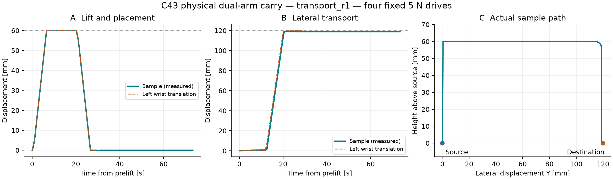

# C43 双臂物理搬运：固定驱动力，无力反馈闭环（2026-11-11）

## 本轮做了什么

此前成功的单臂实验是“更接近重心的抓取几何 + 每指5 N原生关节驱动力”，没有用FT传感器读数调节夹持力。固定驱动力与固定关节位置是两种控制方式；原先的固定位置配方仍有掉落记录，不能把结果概括成只用原位置指令也已成功。

本轮把双臂实际夹持、共同抬升、横向搬运、放下、释放和退回串成独立的无GUI流程。四指在搬运时各施加固定5 N驱动力，FT仅记录；接触消息用于阶段判定，关节速度用于低速闭合，样件位姿用于偏差停止与完成检查。这里“无力反馈”不等于没有关节反馈、接触判定或状态监测。

**两轮完整搬运均通过本轮诊断检查。** 四指接触、空中无支撑、目标落座、松爪后无机器人接触及几何审计均已核实。

## 场景、路径与完成条件

- 完整双臂模型，原STL，0.35 kg / 120×50×50 mm样件，原生效接触参数；无DetachableJoint、无weld、无外部支撑样件的施力。
- 原支撑不动；临时世界增加同尺寸接收支撑，底面中心world `(0,0.12,0)`，顶部z=0.25 m。目标样件中心 `(0,0.12,0.275)`。
- 使用此前通过张爪验证的抓取候选：左右TCP world X=±25 mm，分别绕world Y向外倾15°。正式冻结q_grasp12、transport_baseline.yaml与正式world未替换。
- 顺序：张爪→右预抓取→左预抓取→左下降→右下降→四指低速闭合→确认同一完整接触消息包含四指→1.25/2.5/3.75/5 N分级加载→静置3 s→双臂抬高60 mm→保持5 s→横向Y+120 mm→下降60 mm→静置3 s→张爪→抬爪退离→回到源支撑上方→两臂依次home→样件静置5 s。
- 搬运阶段左右臂轨迹使用同一仿真时间戳作为起点，两份action goal均发送后再等待结果，避免把两条手臂串行执行。
- 若任一夹爪总开口<48 mm持续30 ms，或样件相对两腕平均预测位置偏差>15 mm则停止。第二轮起，放下后须明确检测到接收支撑接触才能松爪；第一轮用事后原始消息审计核实同一条件。
- 最终要求：样件中心距目标<10 mm，退离后无手指接触，仍接触接收支撑。此阈值是本轮诊断完成标准，不是正式W7验收指标。

## 离线检查

扩展 `c43_candidate_probe --transport`，从已验证候选读取12关节与两侧TCP，生成5 mm笛卡尔增量的IK路径，并以实际URDF FK校验残差/限位。每段相邻解之间再检查5个关节插值状态，home/接近路径单独采样。共1035个检查状态通过，最小两臂间距约24.123 mm。

包含完整机器人18个mesh碰撞形状、源支撑、接收支撑、样件与保守地面平板。仅在持物阶段允许样件与四根手指接触，不豁免两臂间碰撞或样件与腕部碰撞。闭爪碰撞检查使用±25.1 mm名义手指位置；真实接触/滑移由实跑记录另行核对。源/目标支撑之间的搬运在样件底面抬高60 mm后进行。

以上为离散机器人碰撞检查，不是连续碰撞证明，也不是对所有真实夹持形变的证明。搬运全程接触与几何结果见后面的原生审计。

## 实际启动命令与文件

宿主日志根：`/home/yep/s622_dual/log/c43_dual_transport_20261111/`；容器对应 `/workspace/log/c43_dual_transport_20261111/`。

离线规划（candidate_spec.txt为此前候选的12关节、左TCP xyz+quat、右TCP xyz+quat，共26个数）：

```bash
docker exec -w /workspace s622_yep bash -lc 'source /opt/ros/humble/setup.bash; source install/setup.bash; cmake --build build/dual_arm_pose_optimization --target c43_candidate_probe -j2 > log/c43_dual_transport_20261111/build.log 2>&1 && build/dual_arm_pose_optimization/c43_candidate_probe log/c43_candidates_20261111/dual_robot_offline.urdf src/s622_moveit_config/config/s622_dual_arm.srdf log/c43_dual_transport_20261111 --transport log/c43_dual_transport_20261111/candidate_spec.txt > log/c43_dual_transport_20261111/plan.log 2>&1'
```

第一轮完整搬运：

```bash
docker exec -w /workspace s622_yep bash -lc 'source /opt/ros/humble/setup.bash; source install/setup.bash; C43_LAB_DUAL=1 C43_CANDIDATE_JSON=/workspace/log/c43_candidates_20261111/dual_split25_tilt15_path.json C43_TRANSPORT_JSON=/workspace/log/c43_dual_transport_20261111/dual_transport_path.json C43_CLAMP_N=5 python3 src/gz_launch/scripts/c43_force_lab.py /workspace/log/c43_dual_transport_20261111/transport_r1 dual_transport .0249'
```

第二轮使用相同命令，将输出目录改为 `transport_r2`。输出目录须尚不存在，脚本拒绝覆盖。基础Gazebo命令由诊断launch生成，使用 `-r -v 4 -s`，不启动GUI。

本轮第一次Docker调用在沙箱内遇到socket权限拒绝，按用户已有要求在沙箱外重试成功；后续以实际CLI执行结果为准。每轮独立ROS_DOMAIN_ID=146、IGN_PARTITION=c43-force-transport_rN。只清理本轮进程组。

关键入口：`c43_dual_transport.py`（阶段机与同步轨迹）、`c43_dual_force.cpp`（四指原生力发布）、`c43_force_lab.py`（临时场景与进程管理）。正式全流程executor未在本轮接入。

每轮保存：

- `launch.log`、`probe.log`、`summary.json`、`conditions.json`、实际robot/world与脚本快照；
- `contacts_raw.txt`、`contacts.jsonl`，后者保留每条完整消息中的全部样件碰撞对与四指区分；
- 四指FT原始流、`four_finger_ft.jsonl`、16关节telemetry；
- 两腕、四指、样件的原生位姿和年龄，`native_poses.jsonl`；
- `transport_audit.json`、`native_transport_geometry.jsonl`：原生同时间戳接触与STL几何核对。

审计命令：

```bash
docker exec -w /workspace s622_yep python3 src/gz_launch/scripts/c43_dual_transport_analyze.py log/c43_dual_transport_20261111/transport_r1
```

## 实测结果

| 轮次 | 保持后样件抬升 mm | 最终Y搬运量 mm | 最终目标位置误差 mm | 搬运最大姿态偏转 | 四指共同接触消息/搬运消息 | 原生同时间戳帧 |
|---|---:|---:|---:|---:|---:|---:|
| transport_r1 | 60.002 | 118.819 | 1.181 | 0.498° | 5316/5316 | 6528 |
| transport_r2 | 60.002 | 118.748 | 1.252 | 0.498° | 5325/5325 | 6507 |

第二轮最终中心约 `(0.0000183,0.1187484,0.27499997)` m。四指最大几何重叠见证0.0131 mm；最终静置1016条消息全部接触接收支撑、没有机器人接触。两轮最终5 s静置均未掉落。

第一轮：抬升后样件中心z≈0.335002 m；搬运后最终中心约 `(0.0000158,0.1188194,0.27499996)` m，距目标1.181 mm。最大物体姿态偏转0.498°。第一轮抬升/保持/横移/下降阶段共5316条完整消息全部包含四指；横移阶段无源支撑或目标支撑接触，排除了靠支撑拖过去。最后静置1013条消息均接触目标支撑且没有机器人接触。

原生位姿与Contacts精确仿真时间戳匹配6528帧，仅采用七个位姿年龄均为0的帧。四指STL顶点深入样件盒的最大见证约0.0135 mm，未复现此前毫米级深重叠；此量不是Gazebo提供的penetration depth，消息本身没有该字段。

横移结束的瞬时样件Y≈113.590 mm，随后在放下时接近目标，最终Y≈118.819 mm。这个瞬时滞后不能称为全程高精度刚性跟随；本轮验证的是完整物理搬运与落座释放。



图来自实际telemetry，虚线是实测左腕平移量，不是理想化样件曲线。高度为相对抬升前样件中心的变化。

`comparison.json` 汇总两轮结果。`transport_audit.json` 中的diagnostic_pass要求：脚本完成；抬升/保持/横移/下降全程四指接触；保持与横移无任何支撑接触；最终持续接触接收支撑且无机器人接触；目标位置误差<10 mm；搬运最大STL顶点深入见证<0.1 mm；最大物体姿态角<5°。这些是本轮事后诊断检查，不能冒充正式验收标准。

新增C++路径生成目标构建通过，相关Python均通过py_compile，git diff --check通过；生成模型实查均有4个ApplyJointForce插件、4个FT sensor、无DetachableJoint。源快照及SHA256保存于 `source_snapshots/`、`source_sha256.json`。两轮隔离Gazebo均已结束，既有PID42896、42900、299501保持运行，见 `remaining_simulations.json`。

## GUI复跑入口（同日补充）

宿主机运行 `bash src/gz_launch/scripts/run_c43_dual_transport_gui.sh`。脚本同步当前桌面XAUTHORITY到容器临时文件，使用Mesa软件渲染，关闭同目录的上一轮GUI实验以避免ROS域冲突，控制器就绪后等待20 s，再执行搬运。每轮创建带时间戳的新日志目录，完成后GUI保留，终端Ctrl+C清理本轮进程。

首次gui_r1遇到旧X11 cookie失效，gui_r2遇到OpenGL上下文创建失败；均已单独停止。修复授权并设置LIBGL_ALWAYS_SOFTWARE=1、LIBGL_ALWAYS_INDIRECT=0、__GLX_VENDOR_LIBRARY_NAME=mesa后，gui_r3真实打开Gazebo窗口并完成搬运，summary.error=null、physical_transport_complete已记录。其日志在 `log/c43_dual_transport_20261111/gui_r3/`，窗口保留供查看。

## 结论边界

在本轮特定样件、几何、原生接触参数与低速短距离路径下，固定驱动力可以完成真实双臂搬运，不要求先加入FT闭环。需要力闭环与否，应由后续载荷变化、抗扰动、精度和安全需求决定，不能从一次固定条件的通过推导“力反馈永远不需要”。

本轮是两臂共同持物的pick/carry/place，未做一臂释放、另一臂单独接物的交接；也未替代正式QP/W7验收。正式入口接入、长距离/变载荷与扰动测试应在这条可复现基线上继续。
