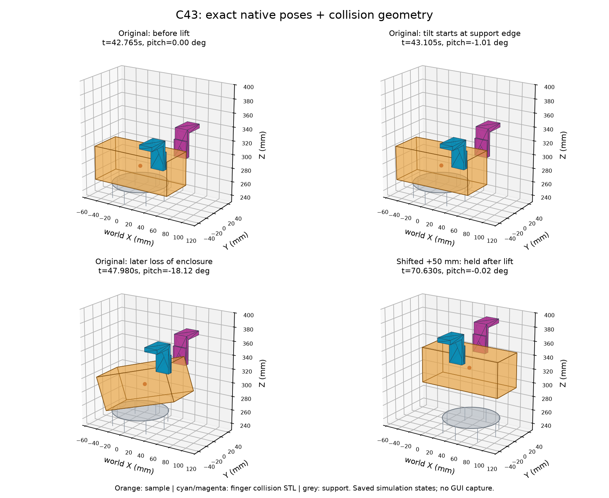

# C43 失稳路径与抓取几何对照（2026-11-11）

## 已定位的现象与成功组合

**当前单臂诊断的恒力失稳顺序是：偏端部抓取 → 样件在支撑负 X 一侧翻起 → 相对下滑 → 后期开口塌缩与深几何重叠。** 大重叠在倾斜之后出现，不能把它直接认定为首因。

保留同一 STL、同一 0.35 kg / 120×50×50 mm 样件、同一手臂轨迹、同样每指 5 N，只把样件与支撑一起沿 world X 平移 +50 mm，使接触更接近重心：三次完整跟随抬升，末值分别 **49.999 / 49.992 / 49.992 mm**，后两次保持 **20 s**，全程维持双指接触。

但同样平移后，原固定位置配方 ±0.0249 m 仍在保持阶段掉落。因此，本轮展示成功的是“改善相对抓取位置 + 受控恒力保持”的组合，不能宣称几何调整单独解决所有位置控制问题，也不能宣称所有位置控制都不可能成功。

这仍是**单臂诊断对照**，不是双臂协同/正式 W7 验收。临时场景平移不能直接当作正式修复；正式方案需将相对抓取关系转化为候选位姿，重新验证双臂可达性、互碰、接物空间及受力同步。不能把两个夹爪都简单移到同一个重心位置。



图中橙色是样件，青/紫是手指碰撞 STL，灰色是支撑。直接使用保存的原生位姿重建，不是 GUI 截图或概念示意。SVG 同名文件也已保存。

## 证据链与时间对齐

先离线复盘五轮既有日志，发现恒力组先绕 Y 倾斜，位置组主要是竖直相对滑移。旧 CSV 通过 ROS 回调拼接关节与位姿，快速失稳阶段存在时序近似，不能仅凭它证明穿透。

新增原生 /world/c43_s4_world/pose/info 采集，与原生 Contacts 按完全相同的仿真时间戳匹配。只采用样件、wrist3、finger1、finger2 四个原生位姿年龄均为 0 的帧。几何重建直接使用两个手指的实际原生位姿，**不依赖 ROS 关节状态做 FK**。采样约 50 Hz，事件发生时刻的精度受该间隔限制。

当前 Contacts 消息实际只有碰撞对和位置点，没有 normal/depth 字段；报告没有把空字段当作零法向或零穿透。原生几何方法把 STL 顶点变换到样件盒坐标系，检查顶点是否深入盒内。该值是**几何重叠见证，不是 Gazebo penetration depth，也不是整对刚体的最小分离距离**。

## 原始抓取位置发生了什么

代表性原生复测：log/c43_force_20261111/escape_native_force5_r1。

| 事件 | 仿真时间 | 观测 |
|---|---:|---|
| 抬升前 | 42.765 s | 样件水平，支撑接触存在，两指接触 |
| Y 向俯仰超过 1° | 43.105 s | 样件开始在支撑负 X 一侧翻起 |
| 相对竖直滑移超过 1 mm | 43.165 s | 已出现姿态失稳和跟随不足 |
| 总关节开口低于 48 mm | 47.980 s | 后期开口塌缩 |
| finger1 顶点深入样件盒 >1 mm | 47.980 s | 与塌缩同时；最大见证约 6.57 mm |

抬升原生帧中 **258/262** 仍报告与支撑接触。末帧样件俯仰约 **-18.11°**，腕部抬升约 **32.14 mm**，样件中心仅升高约 **17.15 mm**；不能算作已经自由持物。少量帧支撑接触短暂消失后又恢复，不能描述成全程连续单一支点。

两指原生位姿与关节轴关系的最大残差约 0.000763 mm，远小于毫米级重叠，排除了“仅由 ROS 关节读数误差产生假穿透”的解释。

抬升前，样件局部接触区约为：

- finger1：X=39.47～40.20 mm，Y≈-25 mm；
- finger2：X=59.16～59.91 mm，Y≈+25 mm；
- 两者 Z≈14.50～25.00 mm，只覆盖样件上部约 **10.5 mm** 高度。

接触位于 +X 端附近，距重心约 50 mm。以 0.35 kg 和约 50 mm 力臂估算，抬升需抵抗约 **0.17 N·m** 量级的偏心俯仰力矩。日志中首先出现的主要转动正是 Y 向俯仰。该力矩解释与观察一致，但没有测得完整的指面接触力分布，不能当作完整力闭合计算。

位置组与恒力组失稳不同：原位置的 ±.0249 配方可以较好保持水平，但物体会相对手指向下滑移，随后回落。不能把两种模式统称为同一“第一次接触即失败”。

## 对照矩阵

所有对照均无右臂、无 weld；样件质量、尺寸、手臂路径不变。固定位置组与恒力组闭合过程不同，不能作为同一闭合历史下的单一力值因果实验。

| 条件 | 腕部末升高 mm | 样件末升高 mm | 保持 | 结果 |
|---|---:|---:|---:|---|
| 原 STL、原位置、5 N 原生复测 | 约32.14（停止时） | 约17.15（停止时） | 未完成 | 倾斜、仍触支撑、塌缩/重叠 |
| 原位置、三盒碰撞、5 N | 50.000 | 26.876 | 5 s | 仍倾斜，未完整离开支撑 |
| 原位置、修正参数引用、5 N | 15.035（停止时） | 7.188（停止时） | 未完成 | 仍倾斜并触发停止 |
| 原 STL、X+50 mm、5 N，r1 | 50.000 | 49.999 | 5 s | 完整抬升、双指接触 |
| 原 STL、X+50 mm、5 N，r2 | 50.000 | 49.992 | 20 s | 完整抬升、双指接触 |
| 原 STL、X+50 mm、5 N，r3 | 50.000 | 49.992 | 20 s | 完整抬升、双指接触 |
| 原 STL、X+50 mm、固定位置 ±.0249 | 50.001 | -0.191 | 20 s | 峰值43.059 mm，后回落 |

平移恒力组只在抬升开始的 1～2 个原生帧报告支撑接触，随后脱离。20 s 两轮保持阶段分别有 4004 / 4007 条完整接触消息，均同时包含两指；顶点深入盒内的最大见证不到 0.009 mm。最终跟随误差约 0.009 mm，未出现原位置的大俯仰或深重叠。

该平移同时改变了相对重心力臂和端边余量，尚未把这两项几何因素单独解耦。接触高度没有改变，因此不能声称“增加插入深度”是本次成功原因。

固定位置平移组单次仍失败，说明本次具体位置配方尚不稳定；并非证明所有位置控制都不可能持物。5 N 组合三次成功是受测条件下的结果，不签发长期成功率结论。

## 网格碰撞表示的影响

两个手指 STL 均有 32 个三角面、18 个唯一顶点，各存在一条四面共边；这是非二流形拓扑特征，不能据此直接称 STL 损坏或认定其为首因。

诊断中用三个经 local Y +0.5° 旋转的盒体保留原外轮廓，视觉、质量和惯量不变；从原 SDF 复制非几何碰撞属性。STL 体积约 8.8259982e-6 m³，盒体并集体积 8.826e-6 m³；顶点/边中点/三角形重心 224 点的拟合外部距离最大约 0.00231 µm。这是抽样拟合验证，不是完整 Hausdorff 距离证明。

原位置三盒组的最大顶点深入见证约 **0.019 mm**，相比原网格复测的 **6.57 mm** 显著减少；但末俯仰仍约 **-30.27°**，650 个抬升/保持原生帧中 646 帧仍有支撑接触，样件中心只升高 26.876 mm。

这把两个环节区分开：改变碰撞表示能避免本轮的深重叠，但并未解决偏心抓取造成的翻起。具体是内部面、非流形特征还是引擎的网格接触处理导致后期差异，尚未单独分离。

## 发现的配置问题

src/gz_launch/config/c43_s4_dual_arm_gazebo.urdf.xacro 的摩擦段把 mu1/mu2/kp/kd 放在 gazebo reference="left_finger1_joint" 等 joint 引用上，而非 finger link。当前实际生成的 SDF 手指 collision 没有这些 surface 参数；不能把源码中的 mu=500 当作已经生效的物理参数。

只在临时生成 URDF 中将引用改到 left_finger1 / left_finger2 后，转换出的 SDF 确实具有 mu=500、kp=30000、kd=15。该候选仍在原位置失稳，不能作为已验证的夹持修复。

因此这里有两件事：引用绑定错误需要配置清理；而旧数值 500/30000/15 本身尚未标定，不能直接作为正式推荐值。正式 xacro 未改，候选输入和 friction_reference_fix.json 保留在日志中。

## 文件与复现

新日志根目录：/home/yep/s622_dual/log/c43_escape_20261111。

- comparison.json / comparison.csv：输入条件、抬升和保持数据；completed 只表示脚本走到末尾，不代表夹持成功。
- 每轮 native_poses.jsonl、native_pose_examples.txt、native_escape_audit.json、native_escape_geometry.csv：原生时间对齐与几何证据。
- contacts_raw.txt、contacts.jsonl、FT 原始流、telemetry.csv、world/robot、conditions.json、probe/launch 日志、脚本快照。
- mesh_representation_audit.json：拓扑、体积和三盒拟合检查。
- 原位置原生基线在 log/c43_force_20261111/escape_native_force5_r1；既有五轮的离线 ROS 近似审计写在各自 escape_audit.json / escape_geometry.csv，未与原生精度混淆。

```bash
# 成功对照：新输出目录；只在临时场景平移样件与支撑，保持20 s。
docker exec -w /workspace -e C43_CLAMP_N=5 -e C43_CAPTURE_NATIVE_POSES=1 \
  -e C43_LAB_SCENE_DX=.05 -e C43_LAB_COLLISION=mesh -e C43_HOLD_LIFT_S=20 \
  s622_yep bash -lc \
  'source /opt/ros/humble/setup.bash; source install/setup.bash; python3 src/gz_launch/scripts/c43_force_lab.py /workspace/log/c43_escape_20261111/NEW_CENTERED_RUN force .0249'

# 原位置三盒碰撞对照：C43_LAB_SCENE_DX=0, C43_LAB_COLLISION=boxes。
# 原位置参数引用候选：C43_LAB_CONTACT_PROFILE=link_intended。

docker exec -w /workspace s622_yep python3 \
  src/gz_launch/scripts/c43_native_escape_audit.py log/c43_escape_20261111/NEW_CENTERED_RUN
docker exec -w /workspace s622_yep python3 \
  src/gz_launch/scripts/c43_force_lab_analyze.py log/c43_escape_20261111
```

原始 q_grasp12、正式场景、正式执行器及用户既有 FT/xacro 改动均未改变。每轮是独立 ROS domain/IGN partition 的无 GUI 单臂诊断，结束后清理隔离进程组，原有仿真保留。

新增/扩展诊断代码：c43_escape_audit.py、c43_native_pose_record.py、c43_native_escape_audit.py、c43_mesh_representation_audit.py、c43_escape_plot.py，以及 force_lab 的临时场景/碰撞表示/参数引用选项和可配置保持时长。原生图已目视检查；Python 编译和 git diff --check 通过。

正式迁移下一步应把验证有效的物体—夹爪相对关系落实为候选抓取位姿，并在实际双臂任务中验证碰撞、持物/接物空间和负载分配；本轮没有把两个夹爪一起移到重心，也没有替代双臂全流程验收。
