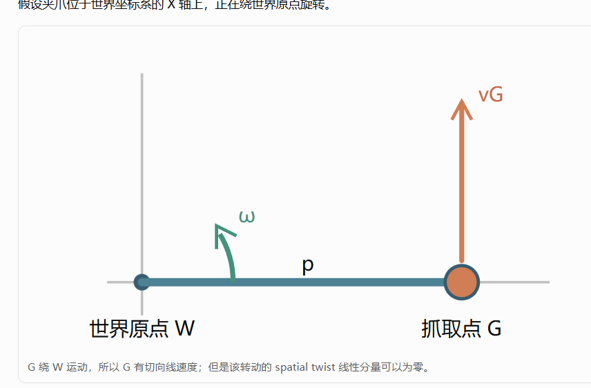

你这次提出的几个疑问，其实都指向同一个根本问题：

我们之前没有把“坐标轴”和“参考点”分开讲清楚。这会直接导致 Body Jacobian、Spatial Jacobian 和 Adjoint 看起来像三套莫名其妙的公式。

我重新对照了你仓库里的 `dual_arm_kinematics.hpp` 和 `dual_arm_kinematics.cpp`。你的代码对这几种 Jacobian 的约定其实写得很清楚。


这次我们只解决四件事。

## 一、什么是“线速度参考点”？

先暂时忘记机器人，想象一根绕左端旋转的杆子。

*（示意图：杆子绕 A 转动，A 线速度为零；C 和 B 都有线速度，且离 A 越远速度越大。）*

这根杆子是刚性的，各个点的角速度相同。

但是：

* A 点的线速度为零；
* C 点有一定线速度；
* B 点的线速度更大。

这说明什么？

一个刚体可以只有一个角速度，但不同位置的点具有不同的线速度。

对于刚体上的两个点 A、B：

$$
\mathbf v_B=\mathbf v_A+\boldsymbol\omega\times\mathbf r_{AB}
$$

其中：

* $\mathbf v_A$：A 点的线速度；
* $\mathbf v_B$：B 点的线速度；
* $\boldsymbol\omega$：刚体角速度；
* $\mathbf r_{AB}$：从 A 指向 B 的位置向量。

所以当我们说：

> 机械臂末端的线速度是 $v_x,v_y,v_z$。

你应该立刻问：

哪个点的线速度？法兰中心？夹爪中心？TCP？还是世界原点？

这个点就叫线速度参考点。

### 对应到你的 S622

假设一个机械臂有：

* `base_link`：基座坐标系；
* `grasp_frame`：夹爪抓取坐标系。

你的 `jacobianBase()` 注释明确规定：

> 线速度参考点是 grasp 原点，速度分量在 base 坐标轴下表达。

因此：

$$
J_{\mathrm{base}}\dot q=
\begin{bmatrix}
{}^B\mathbf v_G\\
{}^B\boldsymbol\omega
\end{bmatrix}
$$

其中 $\mathbf v_G$ 是夹爪抓取点 G 的线速度，不是 base 原点的速度。

注意区分下面两句话：

* “在 base 坐标系表达速度”：指三个速度分量沿着 base 的 XYZ 坐标轴。
* “线速度参考点是 grasp 原点”：指我们研究的是夹爪抓取点 G 在怎么运动。

速度在哪个坐标轴表达，不决定速度属于哪个点。

这是你理解后面两个函数的基础。

## 二、为什么 `jacobianBody()` 只乘旋转矩阵？

现在直接看你的真实源码：

```cpp
Mat6 DualArmKinematics::jacobianBody(
    Arm a, const JointConfig& q) const
{
    const Mat3 R_gb =
        baseTgrasp(a, q).linear().transpose();

    Mat6 R6 = Mat6::Zero();
    R6.topLeftCorner<3, 3>() = R_gb;
    R6.bottomRightCorner<3, 3>() = R_gb;

    return R6 * jacobianBase(a, q);
}
```

这里我们只需要关注三种量：

| 量 | 线速度参考点 | 速度表达坐标轴 |
| --- | --- | --- |
| `jacobianBase()` | grasp 原点 G | base 坐标轴 |
| `jacobianBody()` | grasp 原点 G | grasp 坐标轴 |
| 二者差异 | 没有换参考点 | 换了坐标轴 |

你看，两个 Jacobian 描述的都是同一个夹爪抓取点。

唯一的变化是观察速度的坐标轴。

假设夹爪沿世界正 X 方向运动，但夹爪自身已旋转，那么这一运动在夹爪的局部 XYZ 坐标轴中就会有不同的分量。

要完成这个转换，只需用旋转矩阵：

$$
{}^G\mathbf v_G=R_{GB}\,{}^B\mathbf v_G
$$

角速度同样旋转：

$$
{}^G\boldsymbol\omega=R_{GB}\,{}^B\boldsymbol\omega
$$

将它们拼成一个六维表达：

$$
J_b=
\begin{bmatrix}
R_{GB}&0\\
0&R_{GB}
\end{bmatrix}
J_{\mathrm{base}}
$$

这正是你 `jacobianBody()` 中 `R6` 所做的事。

为什么没有平移叉乘项？

因为线速度参考点始终都是 G，没有从夹爪中心改到另一个点。

## 三、为什么 `spatialJacobianWorld()` 又必须使用 Adjoint？

你的另一个函数是：

```cpp
Mat6 DualArmKinematics::spatialJacobianWorld(
    Arm a, const JointConfig& q) const
{
    return adjoint(worldTgrasp(a, q))
         * jacobianBody(a, q);
}
```

这里不要把 Spatial Jacobian 简单理解为：

> 把夹爪中心的线速度旋转到世界坐标轴。

它比这个多做了一件事情。

在你这个项目的定义中：

* Body Jacobian：线速度参考点为 grasp 原点，轴在 grasp 系；
* Spatial Jacobian：使用世界系的 spatial twist，线性分量以世界原点为参考。

严格说，Spatial twist 的线性分量是一种参考于世界原点的运动表示，并不等于“物理上世界原点跟着夹爪运动”。世界系本身仍然固定。

对一个末端位姿：

$$
T=\begin{bmatrix}R&p\\0&1\end{bmatrix}
$$

如果夹爪原点世界线速度是 $\dot p$，空间角速度是 $\boldsymbol\omega_s$，那么 strict spatial twist 的线性分量是：

$$
\mathbf v_s=\dot p-\boldsymbol\omega_s\times p
$$

你可以看到，它需要考虑物体的空间位置 $p$。

所以仅仅使用旋转矩阵是不够的。

我们需要一个能够同时处理：

1. 坐标轴旋转；
2. 速度参考点变化；

的数学工具。

这就是 Adjoint。

采用你项目的 `[线速度; 角速度]` 排列时：

$$
\operatorname{Ad}_T=
\begin{bmatrix}
R & [p]_\times R\\
0 & R
\end{bmatrix}
$$

所以：

$$
J_s=\operatorname{Ad}_T J_b
$$

这就是 `spatialJacobianWorld()` 的原理。

下面用一个小实验，你就能把“同一个点的速度”和“Spatial twist 的线性分量”区分开。

## 四、一个例子：为什么 Spatial 的线速度不一定是末端点速度？

假设夹爪位于世界坐标系的 X 轴上，正在绕世界原点旋转。

*（示意图：G 绕 W 运动，G 有切向线速度；该转动的 spatial twist 线性分量可以为零。）*

假设运动恰好是绕世界原点的纯旋转。

夹爪点 G 的真实线速度：

$$
\dot p=\boldsymbol\omega\times p
$$

但 strict spatial twist 的线性分量：

$$
\mathbf v_s=\dot p-\boldsymbol\omega\times p=0
$$

这不是说夹爪没动！

而是说：这个运动完全可以描述为一个绕世界原点的旋转，所以 spatial twist 不需要额外的线性分量。

这也是为什么：

$$
J_{\mathrm{world,geometric}}
\ne
J_{\mathrm{world,spatial}}
$$

一般不能把这两种 Jacobian 当成同一个东西。

## 五、Adjoint 不是只作用于 Twist 吗？为什么能直接乘 Jacobian？

你这个问题问得非常到位。这恰恰是最应该从数学上理解的部分。

先看两个已知关系。

关系一：Jacobian 将关节速度变为 Body twist。

$$
V_b=J_b(q)\dot q
$$

关系二：Adjoint 将 Body twist 变为 Spatial twist。

$$
V_s=\operatorname{Ad}_T V_b
$$

现在把关系一代入关系二：

$$
V_s=\operatorname{Ad}_T(J_b\dot q)
$$

因为矩阵乘法具有结合律：

$$
V_s=(\operatorname{Ad}_T J_b)\dot q
$$

而 Spatial Jacobian 的定义是：

$$
V_s=J_s\dot q
$$

所以我们得到：

$$
J_s=\operatorname{Ad}_T J_b
$$

这就是 Adjoint 可以直接左乘 Jacobian 的数学证明。

它没有改变 Adjoint 的用途。Adjoint 仍然是在转换 twist，只是我们提前将这个转换作用到了“生成 twist 的线性映射”上。

### 从 Jacobian 的列来看，更容易理解

一条六轴机械臂的 Jacobian：

$$
J_b=
\begin{bmatrix}
| & | & & |\\
j_1 & j_2 & \cdots & j_6\\
| & | & & |
\end{bmatrix}
$$

每一列 $j_i$ 都是：

> 当第 $i$ 个关节以单位速度运动、其他关节静止时，末端产生的六维 twist。

因此，Adjoint 可以分别转换每一列：

$$
J_s=
\begin{bmatrix}
\operatorname{Ad}_T j_1 &
\operatorname{Ad}_T j_2 &
\cdots &
\operatorname{Ad}_T j_6
\end{bmatrix}
$$

这和一次性执行矩阵乘法：

$$
\operatorname{Ad}_T J_b
$$

完全一样。

记住这个关系：

$$
\dot q
\xrightarrow{\ J_b\ }
V_b
\xrightarrow{\ \operatorname{Ad}_T\ }
V_s
$$

也可以提前合并成：

$$
\dot q
\xrightarrow{\ \operatorname{Ad}_T J_b\ }
V_s
$$

两条计算路线是等价的，前提是坐标变换及 twist 的定义一致。

## 六、到底有多少种 Jacobian？

这里需要纠正一个容易产生的误解：

并不是机器人学里只有 Body 和 Spatial 两种 Jacobian，也不是你的项目实现了多少个 Jacobian 函数，就存在多少种完全不同的数学理论。

Jacobian 的本质始终是：

$$
\text{输入的小变化}\longrightarrow\text{输出的小变化}
$$

不同名称往往来自三个选择：

* 任务是什么？单臂末端、双臂相对位姿，还是物体？
* 坐标轴是什么？base、grasp、world？
* 速度参考点是什么？grasp 原点、world 原点，还是其他点？

你的 `dual_arm_kinematics` 当前源码至少有以下几种重要形式。

| 函数或模式 | 表达坐标系 | 线速度参考点 / 类型 |
| --- | --- | --- |
| `jacobianBase()` | 单臂 base | grasp 原点的几何速度 |
| `jacobianBody()` | grasp | grasp 原点，body twist |
| `spatialJacobianWorld()` | world | world 原点，spatial twist |
| `relativeJacobian(BodyR)` | 右 grasp | 双手相对 body twist |
| `relativeJacobian(LeftL)` | 左 grasp | 同一相对运动，在左 grasp 表达 |
| `relativeJacobian(WorldSpatial)` | world | 双手相对运动的 spatial 表达 |
| `relativeErrorJacobian()` | 相对误差的局部坐标 | 六维位姿误差对关节的局部导数近似 |

以上是根据仓库头文件和实现核对的分类。


还需要注意：

`relativeJacobian(BodyR)` 和 `relativeJacobian(LeftL)` 并不是在描述两个不同的机器人任务。

它们描述的是同一个双手相对运动，只是表达方式不同。

就像同一辆车的速度，可以用车体前后左右方向描述，也可以用地图的东西南北方向描述。

## 七、把你的三个单臂函数放在一起理解

我们现在可以很清楚地画出这条转换链：

* `jacobianBase()`：抓取点 G 的几何速度，用 base 坐标轴表达；
* 乘 `blockdiag(Rᵀ, Rᵀ)`：只旋转速度坐标轴；
* `jacobianBody()`：仍然描述抓取点 G 的运动，但用 grasp 自身坐标轴表达；
* 乘 `Ad(worldTgrasp)`：坐标轴和 twist 参考点一起转换；
* `spatialJacobianWorld()`：用 world 表达的 spatial twist，线性分量以世界原点为参考。

这三个函数不是在重复计算三种不同的机械臂运动。

它们本质上是在用三种不同方式表示同一条机械臂的瞬时运动。

而且，三种 Jacobian 都取决于当前关节位形 $q$，因为末端旋转和位姿会随 $q$ 改变。

## 八、最后用三句话检查是否理解

1. 线速度参考点：是我们要描述刚体上哪个点的线速度；同一刚体上不同点的线速度可能不同。
2. Body 与 Spatial：Body 使用末端自己的坐标系；严格 Spatial 使用固定世界空间系及其 twist 约定。两者可以通过 Adjoint 联系。
3. Adjoint 乘 Jacobian：因为 Jacobian 每一列都对应一个单位关节运动引起的 twist，所以可以提前对整个 Jacobian 做 twist 坐标转换。

我建议你在继续看 `relativeJacobian()` 前，先确认自己已经理解：

$$
\underbrace{J_b\dot q}_{\text{末端系 twist}}
\quad\xrightarrow{\operatorname{Ad}_T}\quad
\underbrace{J_s\dot q}_{\text{世界空间 twist}}
$$

如果你能理解这条式子，以及为什么“夹爪原点真实线速度”不一定等于 Spatial twist 的线性分量，那么 `relativeJacobian(BodyR)` 中那个看起来复杂的 Adjoint，就基本具备理解条件了。