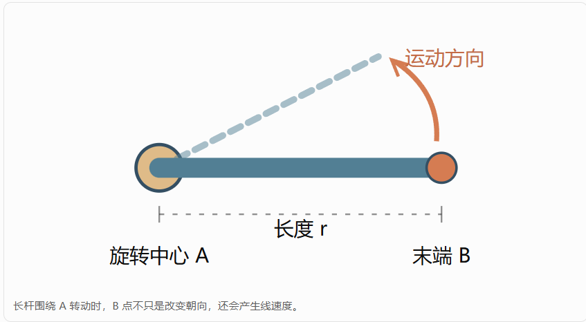

# 第三课：双臂运动学、SE(3) 坐标变换与相对 Jacobian

**S622 双臂 QP 系统 · 数学与源码精读课程**

> 课程定位：这是一份独立的**运动学数学讲义**，不替代 `dual_arm_kinematics` 的变量/函数参数伴读手册。  
> 源码基准：GitHub `Ahhyp/s622_dual` 的 `public` 分支，2026-10-16。主要依据：
> - [`dual_arm_kinematics.hpp`](https://github.com/Ahhyp/s622_dual/blob/public/src/dual_arm_kinematics/include/dual_arm_kinematics/dual_arm_kinematics.hpp)
> - [`dual_arm_kinematics.cpp`](https://github.com/Ahhyp/s622_dual/blob/public/src/dual_arm_kinematics/src/dual_arm_kinematics.cpp)
>
> 阅读边界：以上两个文件已经核对。`se3.hpp` 和额外物体中点实现本次未能完整读取，因此本课关于 `logSE3()` 的实现细节、旧物体中点的具体公式仅作**一般数学解释和待复核专题**，不能视作已逐行审计。涉及示例数字均为教学构造值，不是机器人实测数据。

## 本课的学习目标

完成后，你应该能够：

1. 正确解释 `world_T_left_base`、`baseTgrasp()`、`worldTgrasp()` 的方向和乘法次序。
2. 把两条机械臂的世界系末端变换合成为 `leftTright()`。
3. 区分几何 Jacobian、body Jacobian、spatial Jacobian 与相对 Jacobian。
4. 从双臂 twist 的坐标变换推出 `BodyR` 模式的相对 Jacobian。
5. 理解为什么 `relativeError()` 使用 $SE(3)$ 的 `Log`，以及其线性化为什么存在约定和适用范围。
6. 正确区分机械臂的运动学奇异与 π 旋转中点不唯一的问题。

**先修：**第一课 QP 代码架构、第二课 QP 数学。与本课配合查阅的独立材料：`dual_arm_qp.cpp` 变量字典、函数参数字典。

---

# 1. 机器人为什么需要坐标系？

想象左右两条 S622。左手“前进”究竟是沿世界系 X 轴，还是沿它自己基座的 X 轴？这不能靠一个“前”字决定。

在本项目中，至少有这些系：

| 符号 | 实体 | 用途 |
|---|---|---|
| $W$ | world | 描述整体场景的固定参考系 |
| $B_L$ | 左机械臂 base | 左臂 DH/FK 的参考系 |
| $B_R$ | 右机械臂 base | 右臂 DH/FK 的参考系 |
| $L$ | left grasp | 左夹爪抓取坐标系 |
| $R$ | right grasp | 右夹爪抓取坐标系 |
| $O$ | object | C4.3 物体任务定义的物体系（须与旧中点模型区分） |

源码头文件明确写出：DH 的 `fkine`、`jacobian` 表达在**各自基座系**；这两侧基座的世界朝向不同，所以不能不转换就直接拼 Jacobian。

## 1.1 为什么左、右 base 不一样？

当前默认构型的世界安装变换：

$$
{}^WT_{B_L}: p=(0.35,0,0), \; R=R_z(\pi)
$$

$$
{}^WT_{B_R}: p=(-0.35,0,0), \; R=I.
$$

这来自 `dual_arm_kinematics.cpp` 的 `defaultWorldTleftBase()` / `defaultWorldTrightBase()`，不是想象中的对称假设。

左 base 旋转了 180°，左臂“自己的正 X”在世界里和右臂“自己的正 X”方向可能正好相反。因此直接拿两边基座系 Jacobian 做减法会出错。

---

# 2. 旋转矩阵：先掌握 SO(3)

## 2.1 平面旋转是三维旋转的简化版

平面绕原点旋转 $\theta$：

$$
R(\theta)=
\begin{bmatrix}
\cos\theta&-\sin\theta\\
\sin\theta&\cos\theta
\end{bmatrix}.
$$

三维里，绕 Z 轴转动：

$$
R_z(\theta)=
\begin{bmatrix}
\cos\theta&-\sin\theta&0\\
\sin\theta&\cos\theta&0\\
0&0&1
\end{bmatrix}.
$$

旋转矩阵满足：

$$
R^TR=I,\qquad \det R=1,\qquad R^{-1}=R^T.
$$

所有合法三维旋转构成 $SO(3)$。

## 2.2 为什么不能把两个三维姿态直接“做平均”？

向量位置可以直接平均，但旋转不是普通的欧氏向量。旋转之间的差和中间姿态都需要明确几何定义；例如最短旋转路径上的中点，在相对旋转为 π 时会出现非唯一情况。

这也是你 C4.3 讨论的旧“测地中点”风险，但**不能由此得出两只手相对旋转 π 时无法正常做 FK 或相对运动控制**。

---

# 3. 位姿：SE(3) 和齐次变换

一个刚体位姿由旋转 $R$ 和位置 $p$ 共同表示：

$$
T=\begin{bmatrix}R&p\\0&1\end{bmatrix}.
$$

$R$ 为 3×3，$p$ 为 3×1，$T$ 为 4×4。它属于 $SE(3)$。

## 3.1 读懂 $ {}^AT_B $

我们采用“**B 在 A 中的位姿**”约定：

$$
{}^AT_B
$$

把 B 系表达的坐标转换为 A 系表达：

$$
{}^Ap = {}^AT_B\,{}^Bp
$$

（使用齐次坐标）。

举例，`world_T_left_base` 表示左 base 在 world 中的位姿；`baseTgrasp` 表示 grasp 在 base 中的位姿。

## 3.2 变换为什么可以连乘？

如果知道：

$$
{}^WT_B,\qquad {}^BT_G,
$$

则：

$$
\boxed{{}^WT_G={}^WT_B\,{}^BT_G}.
$$

右边相邻的坐标系 B 可以“抵消”，最终得到 G 在 W 中的位姿。**乘法次序不可任意交换。**

与本项目对应：

```cpp
Iso3 DualArmKinematics::worldTgrasp(Arm a, const JointConfig& q) const {
    return base_[index(a)] * baseTgrasp(a, q);
}
```

这是读懂运动学实现的第一条关键代码。

## 3.3 逆变换怎么求？

若：

$$
T=\begin{bmatrix}R&p\\0&1\end{bmatrix},
$$

则：

$$
T^{-1}=
\begin{bmatrix}
R^T&-R^Tp\\0&1
\end{bmatrix}.
$$

重要：一般**不能**仅把平移列 $p$ 取负；还要旋转到对方坐标系。

---

# 4. FK（正向运动学）在项目中如何组织？

FK 的含义是：已知机械臂每个关节的角度，推算夹爪位姿。

单臂 DH 形式抽象写作：

$$
{}^{B}T_G(q)=T_1(q_1)T_2(q_2)\cdots T_6(q_6)T_{\mathrm{tool}},
$$

但具体 DH 转换中的轴方向、偏置、工具长度需要以 `fairino_planning_core` 实现为准，不应该从一个通用公式反推它的实际参数。

项目中的 `baseTgrasp()`：

```cpp
return toIso(dh_[index(a)].fkine(q, ToolModel::GRIPPER));
```

这里复用了既有 DHKinematics，而不是在 `dual_arm_kinematics` 包中重新写一套 DH 算法。

然后 `worldTgrasp()` 左乘 base 的世界安装变换。**同样的单臂关节角配置，在不同世界安装方位下给出的世界位姿不同。**

## 4.1 十二轴向量怎么拆？

左右臂各六轴：

$$
q_{12}=[q_L;q_R].
$$

源码的 `stack()` 使用 `head<6>()` / `tail<6>()`，`split()` 反向取出左、右各六轴。

这只是数据排列，并不意味着左、右关节变量有相同的世界轴方向。

---

# 5. 双臂相对位姿：`leftTright()`

世界系中，左夹爪和右夹爪分别为：

$$
{}^WT_L(q_L),\qquad {}^WT_R(q_R).
$$

从左手看右手：

$$
\boxed{{}^LT_R=({}^WT_L)^{-1}{}^WT_R}.
$$

`leftTright()` 在真实源码中正是先计算两侧 `worldTgrasp`，然后左侧求逆、右侧相乘。

## 5.1 直观数值例子

仅看平移，假设左手世界 x=0.2 m，右手 x=0.7 m，则右手相对于左手位于 x=0.5 m。

若两手同时右移 0.1 m，得到世界 x=0.3 和 0.8 m，相对间距仍是 0.5 m。

所以：

- **绝对位置**可以改变；
- **相对位姿**可以保持不变。

这就是双臂协同搬运控制的基础。

## 5.2 相对旋转不能忽略

若右手相对左手方向也改变，即使两夹爪原点间距不变，也不再是同一个刚性抓持构型。因此 `leftTright` 是完整的 4×4 刚体变换，而不只是距离。

---

# 6. Jacobian：为什么从关节变化预测末端变化？

对末端位置 $p(q)$ 进行一阶展开：

$$
\Delta p\approx J_p(q)\Delta q.
$$

对完整刚体位姿，需要同时描述三维线速度和三维角速度（twist）。本项目采用六维分量次序：

$$
\boxed{V=[v_x,v_y,v_z,\omega_x,\omega_y,\omega_z]^T}.
$$

源码头文件明确表示 `jacobianBase()` 是**几何 Jacobian**：

- 分量按 `[linear; angular]`；
- 轴在机械臂 base 系表达；
- 线速度参考点是 grasp 原点。

这些约定非常重要。不同机器人工具库有时使用 `[angular; linear]`，因此不能不核对直接相乘。

**Body Jacobian 和 Spatial Jacobian**

Body Jacobian 和 Spatial Jacobian 都在描述机械臂关节速度与末端运动速度之间的关系。它们最重要的区别在于速度采用哪个坐标系表达，以及线速度的参考点如何定义。Adjoint 则是连接不同刚体坐标系下 twist 表达的数学工具。

$$
V = J(q) \dot q
$$
这个速度 V 中的 X、Y、Z，究竟是世界坐标系的，还是夹爪自己的？

Body Jacobian：用夹爪自己的坐标轴 (base, left, right 坐标系) 描述运动
$$
V_b = J_b(q) \dot q
$$
Body Jacobian 的作用
- 在你的项目中，它特别适合描述：
- 某个夹爪相对于自身坐标轴的运动；
- 右夹爪坐标系下的双臂相对运动；
- 把位姿误差与 Jacobian 统一到相容的坐标系；
- 计算相对抓取约束。

对于两端固定抓住箱子的任务，末端局部坐标系往往比世界系更自然。

Spatial Jacobian：用固定世界坐标系描述空间运动
$$
V_s = J_s(q) \dot q
$$

你可以先把它理解为“从世界坐标系观察刚体怎么运动”。

例如夹爪沿世界 X 方向运动，即使夹爪自己已经旋转了，空间系下的 X 方向仍然固定。

不过这里有一个容易出错的数学细节：

严格的 Spatial twist 的线速度分量，不一定是夹爪原点在世界坐标系中的线速度。

要分清：

|类型 | 线速度代表什世界系几何 |
| --- | --- |
|Jacobian | 通常是末端参考点的真实世界线速度 |
|严格 Spatial Jacobian | Spatial twist 的线性分量，通常以世界原点为参考|
|Body Jacobian | Body twist 在末端系中的表达|

这也是为什么阅读你的 jacobianBase()、jacobianBody()、spatialJacobianWorld() 时，必须同时检查坐标系、速度排列和参考点。

## 6.1 `jacobianBase()` 与 `jacobianBody()` 与 `spatialJacobianWorld()`

`jacobianBase()` 直接从 DH 后端取得 Jacobian。

`jacobianBody()` 用抓取系朝向的转置旋转矩阵，对两组六维分量分别旋转：

$$
J_{\mathrm{body,geom}}=
\begin{bmatrix}
R_{GB}&0\\0&R_{GB}
\end{bmatrix}J_{\mathrm{base}}.
$$

这里 $R_{GB}$ 把 base 中表达的分量变为 grasp 中表达，**线速度参考点仍是抓取原点**。这正对应源码第 46～52 行的块矩阵乘法。

> 线速度参考点， 指的就是我们在算哪个点的线速度， 因为一根在旋转的杆上有无数个点， 每个点的角速度虽然相同，但是线速度是不同的。

这一步只是在**同一参考点**转动速度分量的坐标轴，并不自动包括把参考点改到 world 原点的平移交叉项。

比较这两个关键的函数

jacobianBody(): 只做坐标轴旋转
```cpp
Mat6 DualArmKinematics::jacobianBody(
    Arm a, const JointConfig& q) const
{
    const Mat3 R_gb = baseTgrasp(a, q).linear().transpose();
    Mat6 R6 = Mat6::Zero();
    R6.topLeftCorner<3, 3>() = R_gb;
    R6.bottomRightCorner<3, 3>() = R_gb;
    return R6 * jacobianBase(a, q);
}
```
这里需要关注三个量：
| 量 | 线速度参考点 | 速度表达坐标轴|
| --- | --- | --- |
| jacobianBase() | grasp原点 G | base 坐标轴 |
| jacobianBody() | grasp原点 G | grasp 坐标轴 |
|二者差异 | 没有换参考点 | 换了坐标轴 |

两个 Jacobian 描述的都是同一个夹爪抓取点。

唯一的变化是观察速度的坐标轴。

假设夹爪沿世界正 X 方向运动，但夹爪自身已旋转，那么这一运动在夹爪的局部 XYZ 坐标轴中就会有不同的分量。
要完成这个转换，只需用旋转矩阵：
$$
{}^Gv_G = R_{GB} {}^Bv_G
$$
角速度也是旋转
$$
{}^G\omega = R_{GB}{}^B\omega
$$
拼接成六维表达就是：
$$
J_{\mathrm{body,geom}}=
\begin{bmatrix}
R_{GB}&0\\0&R_{GB}
\end{bmatrix}J_{\mathrm{base}}.
$$
为什么没有平移叉乘项？

因为线速度参考点始终都是 G，没有从夹爪中心改到另一个点。

`spatialJacobianWorld()`: 使用完整的 Adjoint

```cpp
Mat6 DualArmKinematics::spatialJacobianWorld(
    Arm a, const JointConfig& q) const
{
    return adjoint(worldTgrasp(a, q)) * jacobianBody(a, q);
}
```
第一步：

`jacobianBody()` 得到抓取坐标系中的 twist。

第二步：

`adjoint(worldTgrasp(...))` 把它转换成世界坐标系下的 spatial twist。

数学上：
$$
J^W_s = Ad_{ {}^W T _G } J_b^G
$$
---


这一块可以参考 [QA.md](QA.md)


# 7. Adjoint：六维运动的坐标系变换器

Adjoint（伴随变换）是用来把同一个刚体运动的 twist，从一个坐标系转换到另一个坐标系的矩阵。



假设旋转中心 A 不动，但杆子绕 A 转动。

那么：
- A 点的线速度是零；
- B 点的线速度却不是零；
- A 和 B 的角速度相同。

两点线速度满足$v_B = v_A + \omega \times r_{AB}$， 是从 A 指向 B 的向量。

这就是核心：
描述刚体运动时，改变参考点不仅需要旋转坐标轴，还可能需要额外计算旋转造成的线速度。
Adjoint 将坐标系旋转、平移及这种速度耦合统一写进一个矩阵。
对于严格定义的 body 和 spatial twist：
$$
V_s = Ad_T V_b
$$
它是一个 6×6 矩阵，因为输入、输出都是六维 twist。

特别注意：这个式子针对的是严格的 twist 定义。如果两边都是“某个指定末端点的几何线速度”，就必须按参考点规则处理，不能不加区分地套同一个 Adjoint。


对：

$$
T=\begin{bmatrix}R&p\\0&1\end{bmatrix},
$$

若 twist 采用 `[v;\omega]` 且这里的 $v$ 是相应空间 twist 的线性分量，则一种常见的 Adjoint 表达为：

$$
\operatorname{Ad}_T=
\begin{bmatrix}
R&[p]_\times R\\
0&R
\end{bmatrix}.
$$

其中：

$$
[p]_\times=
\begin{bmatrix}
0&-p_z&p_y\\
p_z&0&-p_x\\
-p_y&p_x&0
\end{bmatrix}
$$

满足 $[p]_\times a=p\times a$。

**为什么出现平移项？**旋转一个刚体时，离旋转中心越远的位置可能具有额外的线速度，因此完整空间 twist 变换通常不仅是纯旋转块矩阵。

**重要边界：**具体的 `adjoint()` 块次序、world/body twist 的线速度定义必须和项目 `se3.hpp` 保持一致。本次未能读取该文件，不将这个通用公式冒充为它的逐行实现。

## 7.1 空间 Jacobian 的实现入口

已核对源码中的：

```cpp
return adjoint(worldTgrasp(a, q)) * jacobianBody(a, q);
```

即先得到 grasp frame 中的 body Jacobian，再经 `worldTgrasp` 的 Adjoint 转为以世界坐标表达的 spatial Jacobian。完整验证要检查 `adjoint()` 的代码约定。

---

# 8. 核心重点：双臂 `relativeJacobian()`

设：

$$
T_{LR}=T_L^{-1}T_R.
$$

相对位姿的运动不是简单的“两边 base Jacobian 相减”，因为左、右 grasp 在不同坐标系中表达。

项目有三种输出：

| 模式 | 输出的表达系 | 源码所在位置 |
|---|---|---|
| `BodyR` | 右抓取系 R | `relativeJacobian()` switch 中的第一分支 |
| `LeftL` | 左抓取系 L | 第二分支 |
| `WorldSpatial` | 世界空间 twist | 第三分支 |

## 8.1 为什么 BodyR 有一个 Adjoint？

把左、右 grasp 各自的 body twist 记为：

$$
V_L^L=J_{bL}\dot q_L,\qquad
V_R^R=J_{bR}\dot q_R.
$$

如果想在**右抓取系**描述相对运动，就必须先将左侧速度转换到右系。

项目源码中：

$$
\boxed{V_{rel}^R
=V_R^R-\operatorname{Ad}_{T_{LR}^{-1}}V_L^L}.
$$

因此：

$$
\boxed{
J_{rel}^{BodyR}=
\begin{bmatrix}
-\operatorname{Ad}_{T_{LR}^{-1}}J_{bL}&J_{bR}
\end{bmatrix}.
}
$$
右半边 $J_{bR}$

右夹爪的 Jacobian 本来就在右夹爪坐标系中，所以直接使用。

左半边 $-\operatorname{Ad}_{T_{LR}^{-1}}J_{bL}$

左夹爪的 Jacobian 在左夹爪坐标系中，所以通过 Adjoint 转换到右夹爪坐标系。

前面的负号：

因为计算的是右手相对于左手的运动。左手如果动了，也会改变右手相对于左手的位置关系，其贡献与右手运动方向相反。

最终得出：
$$
V^R_{rel} = J^{BodyR}_{rel} 
\begin{bmatrix} \dot q_L \\ \dot q_R\end{bmatrix}
$$

这就是已核对源码 `relativeJacobian()` `BodyR` 分支的核心公式。你可以把它读为：

- 左手运动使右手相对于左手的运动产生负贡献；
- 但左手 Jacobian 原本在左手坐标系中，必须先变换到右手坐标系；
- 右手 body Jacobian 本来就在右手坐标系中，可直接放到右半边。


一张表格：
|概念 | 它是什么 | 主要解决什么问题|
| -- | -- | -- |
|Body Jacobian J_b | 从关节速度映射到末端自身坐标系的 twist | 用末端自己的方向描述运动|
|Spatial Jacobian J_s | 从关节速度映射到固定空间坐标系的 twist | 用世界参考系描述刚体运动|
|Adjoint Ad_T | 将同一刚体运动的 twist 在不同坐标系之间转换的 6×6 矩阵 | 统一速度表达坐标系及参考点|

## 8.2 `LeftL` 模式

若改在**左抓取系**表达：

$$
\boxed{
J_{rel}^{LeftL}=
\begin{bmatrix}
-J_{bL}&\operatorname{Ad}_{T_{LR}}J_{bR}
\end{bmatrix}.
}
$$

即这次要把右手的速度转到左手系。公式与源码一致。

## 8.3 `WorldSpatial` 模式

若两侧都已经变换为**世界空间 twist**：

$$
\boxed{
J_{rel}^{W}=
\begin{bmatrix}
-J_{sL}^W&J_{sR}^W
\end{bmatrix}.
}
$$

只有在这个前提下，简单的 `[-J_L,J_R]` 拼接才可直接成立。

**常见错误：**把两个不同 base 系的 6×6 Jacobian 直接用 `[-J_left,J_right]` 拼成 6×12。这会让方向与参考点错乱，尤其是项目的左 base 具有 π 的世界旋转。

---

# 9. 六维位姿误差：`relativeError()`

目前的相对位姿：

$$
T_{LR}(q).
$$

期望相对位姿：

$$
T_{LR}^*.
$$

项目源码用：

$$
T_{err}=T_{LR}(q)^{-1}T_{LR}^*,
$$

再返回：

$$
\boxed{e_{rel}=\log_{SE(3)}(T_{err})}.
$$

这不是将两个 4×4 矩阵逐项相减。对刚体位姿应该使用适当的李群误差映射，将误差表示为六维局部坐标。

## 9.1 为什么需要 `Log`？

旋转具有周期性，而原始矩阵元素并不能直接告诉优化器要往哪一个瞬时旋转方向修正。

`logSE3()` 将局部相对刚体变换转为一个六维误差坐标；它涉及旋转对数与平移的耦合。

本次尚未验证 `se3.hpp` 的精确实现，因此在看实现前，不应假设它的平移误差严格等于 `p_target-p_current`，也不应将 `norm(e_rel)` 直接当作“几米的距离误差”。

## 9.2 误差方向为什么重要？

当前代码定义的是：

$$
T_{current}^{-1}T_{target}.
$$

如果你误换成：

$$
T_{target}^{-1}T_{current},
$$

小误差时方向往往相反，控制器可能把本来需要纠正的误差推得更大。

所以第二课讨论的任务纠偏方向，必须与这里实际 `relativeError()` 的定义对接。

---

# 10. `relativeErrorJacobian()` 又是什么？

`relativeJacobian()` 描述相对刚体运动的局部 twist，**并不自动等于**六维误差坐标 $e_{rel}$ 对关节的导数。

误差：

$$
e_{rel}=\log_{SE(3)}(T_{LR}^{-1}T_{target})
$$

再对关节微分，需要考虑 Lie 群 `Log` 的微分与相应左/右 Jacobian。

源码第 115～122 行采用了**小误差近似**：

$$
J_e\approx-\operatorname{Ad}_{T_{err}^{-1}}J_{rel}^{BodyR},
$$

注释明确写出把某个 $SE(3)$ 右 Jacobian 在小误差区域近似为单位矩阵。

因此：

- 当误差很小时，这种近似可能十分实用；
- 当误差很大时，不能自动认为这个矩阵等于严格精确的 `Log` 导数；
- 应看已有有限差分测试，确认当前允许误差范围。

要小心区分：**`relativeJacobian` 和 `relativeErrorJacobian` 不是同一个函数。**

---

# 11. π 奇异问题到底属于哪一层？

到这里，我们能分清两种完全不同的问题：

**类型一：机械臂 / 相对任务 Jacobian 的运动学退化。**

当某些奇异值接近 0 时，某些方向的瞬时运动可能需要很大的关节动作或不可实现。这是 SVD、阻尼等方法处理的对象。

**类型二：以前使用旋转测地中点描述“物体朝向”时，在恰好相差 π 的两端姿态间出现中点非唯一。**

从两个相反的旋转姿态沿最短旋转路径取中点时，可能存在两条同样短的路径，从而得到不同中点。它是**物体姿态定义的歧义**，不代表双臂不能夹住箱子。

本次成功核对的两个源码文件包含相对位姿与 Jacobian 部分，但**没有直接展现旧 `objectJacobianBody()` 的实现**。因此不能仅凭这两个文件给出旧中点 Jacobian 的代码级修复结论。

对 C4.3，更好的研究路线是：

$$
{}^WT_L={}^WT_OG_L,\qquad
{}^WT_R={}^WT_OG_R,
$$

其中 O 是任务给定的物体坐标系；$G_L,G_R$ 是固定抓取变换。

由左右两侧分别推算物体：

$$
{}^WT_{O,L}={}^WT_LG_L^{-1},
\qquad
{}^WT_{O,R}={}^WT_RG_R^{-1}.
$$

用两侧的一致性误差来检查闭环，而不是强迫两个相差 π 的旋转求一个有歧义的测地中点。

---

# 12. 从数学回到源码：真正的学习地图

| 学习概念 | 当前已核对的源码函数 | 对应要回答的问题 |
|---|---|---|
| 世界安装变换 | `defaultWorldTleftBase/TrightBase` | 两个 base 的世界位置与旋转是什么？ |
| 单臂 DH FK | `baseTgrasp()` | 已知关节角，抓取位姿怎样得出？ |
| FK 变到世界 | `worldTgrasp()` | 为什么必须左乘 base 的世界位姿？ |
| 单臂几何 J | `jacobianBase()` | 它的坐标轴与线速度参考点是什么？ |
| 单臂 body J | `jacobianBody()` | 为什么乘两块旋转矩阵？ |
| 世界 spatial J | `spatialJacobianWorld()` | Adjoint 为什么不能用纯旋转代替？ |
| 两爪相对变换 | `leftTright()` | 为什么左侧要先求逆？ |
| 相对运动 J | `relativeJacobian()` | 为什么 `BodyR` 的左侧块有 Adjoint？ |
| 相对位姿误差 | `relativeError()` | 为什么计算 `logSE3(T_current^-1*T_target)`？ |
| 误差 Jacobian | `relativeErrorJacobian()` | 什么叫 `Log` 微分的小误差近似？ |

---

# 13. 自己动手练习

### 练习 A：解释坐标系方向

不看答案，写出：

$$
{}^WT_{B_L}\,{}^{B_L}T_L
$$

是什么变换？为什么不能颠倒两个矩阵的顺序？

**答案：**左抓取系在世界系中的位姿；矩阵乘法通常不交换，而且连乘时相邻坐标系必须衔接。

### 练习 B：手算双臂相对平移

两手无相对旋转，世界 x 坐标分别为 0.2 m 与 0.7 m。若同时右移 0.1 m，两手相对 x 距离是否变化？

**答案：**不变化，仍为 0.5 m。这也是相对约束允许共同平移的直观原因。

### 练习 C：写出 BodyR 分块 Jacobian

已知 `JbL`、`JbR` 与 `T_rel`，填空：

$$
J_{rel}^{BodyR}=[\quad ? \quad|\quad ?\quad].
$$

**答案：**

$$
[-\operatorname{Ad}_{T_{rel}^{-1}}J_{bL}\quad|\quad J_{bR}].
$$

### 练习 D：辨认两类奇异

两手相对旋转恰好 180°，但 `relativeJacobian` 的有限差分结果正常，旧中点 Jacobian 测试失败。这里应该首先研究什么？

**答案：**旧中点位姿定义及其微分问题，不应据此认定机械臂本身处于关节运动学奇异位形。

### 练习 E：对 `relativeErrorJacobian` 保持审查意识

若相对误差很大，为什么不能仅凭“小误差下通过的测试”宣布它在整个 SE(3) 上严格精确？

**答案：**代码明确使用了 `Log` 微分的局部近似；误差增大时被省略的非线性效应可能不能忽略。

---

# 14. 课程验收标准

这一课不是背公式；你应能做到：

- 拿到任意 `world_T_base` 和 `base_T_grasp`，独立写出正确变换链；
- 在纸上推导 `leftTright = inv(worldTgrasp(left))*worldTgrasp(right)`；
- 解释本项目两侧基座为何不能直接拼 `[-J_L,J_R]`；
- 从 `BodyR` 的 twist 变换逻辑解释它的 `Adjoint`；
- 区分 `relativeJacobian` 与 `relativeErrorJacobian`；
- 清楚说出 π 中点歧义与普通运动学奇异的区别。

**下一步阅读建议：**阅读 `se3.hpp` 与它的独立测试，再建立 `dual_arm_kinematics` 专用函数参数/变量伴读手册。那时可把本课保留的 `Log` 约定、Adjoint 精确实现及旧物体中点实现逐一核实，而不是猜测。

---

## 结语

双臂协同控制的关键不只是会写一个 6×12 的 Jacobian，而是始终能回答：

**“这个位姿是相对于谁的？速度表达在哪个坐标系？参考点在哪里？这两边能直接相减吗？”**

如果这四个问题能回答清楚，那么 `dual_arm_qp.cpp` 中大量看起来抽象的矩阵，就会逐渐变得有实际的几何意义。
